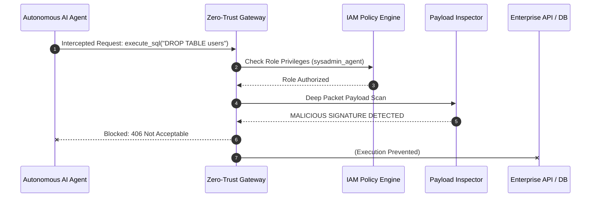

# 🛡️ Zero-Trust AI Agent Gateway
> Role-Based Access Control (RBAC) & Deep Payload Inspection Proxy for Autonomous AI Agents


[](https://github.com/saadcyber21/zero-trust-ai-gateway/actions)


---

## 📖 Executive Summary

* **The Problem:** As enterprises grant autonomous AI agents (LangChain, AutoGPT, CrewAI) direct access to databases, cloud infrastructure, and internal APIs, the risk of "Agent Hijacking" and prompt-injection-driven tool misuse increases exponentially.
* **The Solution:** The **Zero-Trust AI Agent Gateway** serves as a lightweight, security proxy middleware. It intercepts tool call invocations, validates agent identity against strict **Role-Based Access Control (RBAC)** policies, and performs deep payload inspection to prevent destructive actions (e.g., `DROP TABLE`, command chaining, or reverse shells).

---

## 🏗️ Enterprise Architecture



---

## 🎯 Security Control Matrix

| Control Layer | Threat Vector | Mechanism | Framework Alignment |
| :--- | :--- | :--- | :--- |
| **Identity & Access** | Unauthorized Tool Misuse | Strict RBAC Policy Matching | Least Privilege (NIST SP 800-53) |
| **Payload Inspection** | SQL Injection / Destructive DB Commands | Regex Signature Filtering | OWASP LLM01 / LLM02 |
| **System Security** | Shell Command Chaining & Reverse Shells | Parameter Input Sanitization | NIST Cybersecurity Framework |

---

## ⚙️ Environment & Setup

### 1. Prerequisites
* Python 3.11+
* Git

### 2. Installation
```bash
python -m venv venv
source venv/bin/activate  # On Windows: venv\Scripts\activate
pip install -r requirements.txt
```

---

## 💻 Usage & Verification

### Run the Gateway Interceptor
Execute the gateway simulation to evaluate sample benign and malicious agent tool requests:
```bash
python src/gateway.py
```

### Run Automated Pytest Suite
```bash
python -m pytest tests/ -v
```

**Example Output:**
```text
==================================================
DEMO 3: Destructive Payload Interception
==================================================
2026-08-27 18:00:00 - [INFO] - Intercepted Action: Agent[sysadmin_agent] -> Tool[execute_sql_query]
2026-08-27 18:00:00 - [WARNING] - Security Alert: Malicious payload signature matched -> (?i)drop\s+table
{
  "status": "blocked",
  "reason": "Security Alert: Malicious payload or destructive command detected.",
  "http_code": 406
}
```

---

## 🔒 DevSecOps & Quality Assurance

* **CI/CD Pipeline:** Automated GitHub Actions pipeline running `flake8` linting, `bandit` SAST security scanning, and `pytest` execution.
* **Zero Hardcoded Secrets:** Configurable runtime environment via environment variables.

---

## 📄 License
Distributed under the MIT License. See `LICENSE` for details.
